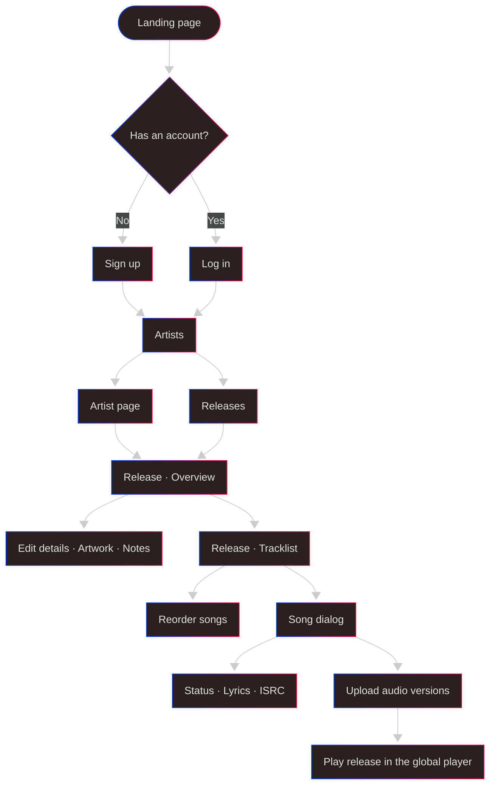

# Cadence — Music Release Planner · Frontend

🔗 **Frontend repo:** [cadence-frontend](https://github.com/danielmuntyanu/cadence-music-release-planner-frontend)

🔗 **Backend repo:** [cadence-backend](https://github.com/danielmuntyanu/cadence-music-release-planner-backend)

📖 **Documentation:** [Backend wiki](https://github.com/danielmuntyanu/cadence-music-release-planner-backend/wiki) · [Frontend wiki](https://github.com/danielmuntyanu/cadence-music-release-planner-frontend/wiki)

## Project Concept

Cadence is a workspace for independent musicians and small labels to run a release from first demo to finished master.

Most artists juggle this across folders, spreadsheets and chat threads: which mix is final, which track is still in recording, where the artwork is, what the ISRC was. Cadence keeps every release, every track and every file in one place — with progress you can see at a glance.

Built by a music producer as the capstone of a Java Full-Stack Developer bootcamp, with the goal of being genuinely usable, not just a demo.

## What it does

| Area | Features |
|---|---|
| **Artists** | Profiles with bio, avatar and banner |
| **Releases** | Title, type, phase, dates, label, genre, notes, artwork; filters, search, sort, pagination |
| **Tracklist** | Songs with gapless positions, drag-and-drop reordering, status, ISRC, explicit flag, lyrics |
| **Progress** | Release progress derived from song statuses: *Writing → Arrangement → Recording → Mixing & Mastering → Done* |
| **Audio files** | Several versions per song, one primary; direct browser-to-storage upload up to 500 MB |
| **Artwork** | Resized for display, original kept for download, metadata stripped |
| **Security** | Cookie-based JWT with refresh, CSRF protection, per-user ownership on every query |

## Tech Stack

| Layer | Technology |
|---|---|
| Language | Java 25 |
| Framework | Spring Boot · Spring Web · Spring Security · Spring Data JPA · Bean Validation |
| Auth | JWT (jjwt) in HttpOnly cookies · BCrypt |
| Database | PostgreSQL 17 (H2 for quick local runs) |
| Storage | S3-compatible: MinIO locally, Cloudflare R2 in production · AWS SDK v2 |
| Media | Thumbnailator for image resizing |
| Testing | JUnit 5 · Mockito · Hamcrest · MockMvc · Testcontainers · JaCoCo |
| Tooling | Maven · Docker Compose · mkcert |

## Architecture

Feature-based packages (`auth`, `users`, `artists`, `releases`, `songs`, `storage`, `media`), each layered **Controller → Service → Repository**, with DTOs and mappers at the edges.

| Highlight | Why it matters |
|---|---|
| **Rich domain entities** | `ReleaseEntity` owns its tracklist: `addSong`, `removeSong`, `reorderSongs` keep positions gapless |
| **Ownership by design** | Every lookup goes through `ReleaseFinder` / `SongFinder` scoped to the current user — another user's data returns `404` |
| **Specifications for filters** | Dynamic queries composed from small `Specification`s, ownership always first |
| **Direct uploads** | Presigned `PUT` URLs: large audio never passes through the API |
| **Private bucket** | All media served through short-lived signed URLs, cached and re-signed in advance |
| **Transaction-safe storage** | Files written to storage are cleaned up if the database transaction rolls back, and deleted only after commit |
| **Consistent errors** | One global handler, one JSON error shape, `401` vs `403` vs `404` used precisely |

Details: [Architecture](https://github.com/danielmuntyanu/cadence-music-release-planner-backend/wiki/Architecture) · [Class Diagrams](https://github.com/danielmuntyanu/cadence-music-release-planner-backend/wiki/Class-Diagrams) · [API Reference](https://github.com/danielmuntyanu/cadence-music-release-planner-backend/wiki/API-Reference) · [Security](https://github.com/danielmuntyanu/cadence-music-release-planner-backend/wiki/Security)

## User Flow



## Quick Start

```bash
docker compose up -d   # PostgreSQL + MinIO
./mvnw spring-boot:run -Dspring-boot.run.profiles=postgres,minio
```

API: `https://localhost:8443/api/v1`. Full setup, including local HTTPS: [Get Started](https://github.com/danielmuntyanu/cadence-music-release-planner-backend/wiki/Get-Started).

## Testing

```bash
./mvnw verify   # tests + JaCoCo report in target/site/jacoco
```

Domain, unit, web and integration tests — the latter on real PostgreSQL and MinIO via Testcontainers. Results: [Testing](https://github.com/danielmuntyanu/cadence-music-release-planner-backend/wiki/Testing).

## Roadmap

| Status | Phase | Scope |
|---|---|---|
| ✅ | **Foundation** | Project setup, cookie-based JWT auth, landing page |
| ✅ | **Artists & Releases** | CRUD, filters, artwork, release detail |
| ✅ | **Tracklist & Files** | Songs, statuses, ordering, audio uploads, global player |
| 🔜 | **Tasks & Events** | Tasks per release, key dates, calendar view |
| 🔜 | **Pitching** | Pitch windows and submissions to playlists and press |
| 💡 | **Later** | Reminders, collaborators, AI assistance for metadata and promo |

## Author

**Daniel Muntyanu** — [GitHub](https://github.com/danielmuntyanu)
